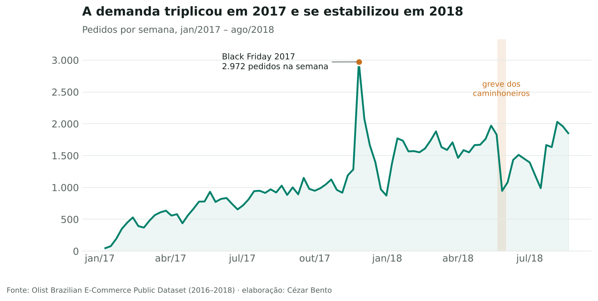
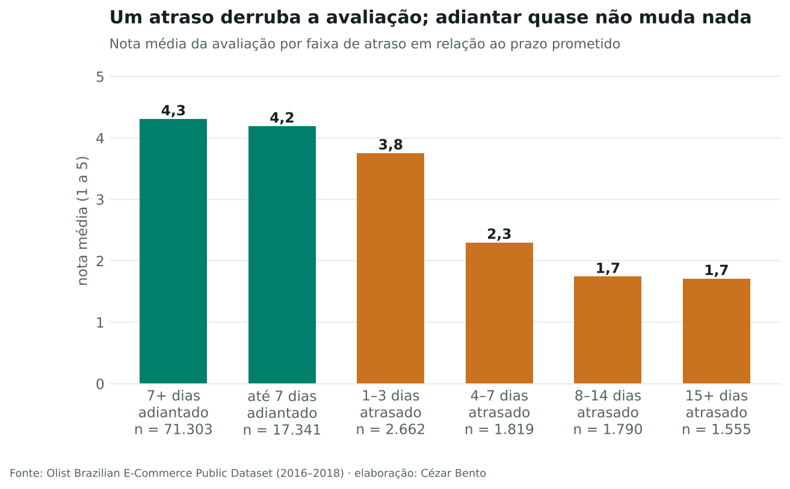
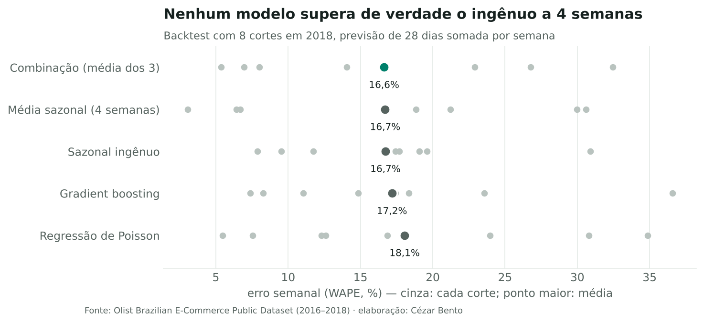

# Previsão de demanda em e-commerce — Olist

**Pergunta:** quantos pedidos a operação deve se preparar para atender nas próximas semanas, e qual a melhor forma de planejar essa capacidade?

**Resposta curta:** a 4 semanas, nenhum modelo supera de verdade a previsão ingênua (todos erram cerca de 17% no total semanal). A demanda muda de patamar por choques que nenhum calendário antecipa. A decisão que mais reduz o erro é **replanejar toda semana**: prever a semana seguinte com o dado mais recente erra **11%**, um terço a menos.

Dados: [Brazilian E-Commerce Public Dataset by Olist](https://www.kaggle.com/datasets/olistbr/brazilian-ecommerce), com cerca de 100 mil pedidos reais de 2016 a 2018.



## Principais achados

1. O volume semanal triplicou em 2017 (5,1 mil → 17,6 mil pedidos por trimestre) e se estabilizou em 2018 ([série](figures/01_serie_semanal.png) · [calendário](figures/05_calendario.png))
2. Atrasar de 4 a 7 dias derruba a nota média de 4,2 para 2,3; adiantar quase não muda nada ([atraso × nota](figures/04_atraso_nota.png))
3. A Olist prometia, em média, 13 dias a mais do que entregava, o que abre espaço para testar promessas mais curtas ([prometido × real](figures/03_dumbbell_prazo.png))
4. A entrega leva 9 dias em SP e quase 30 em RR; no Norte, o frete pesa 36% do preço do item, contra 21% no Sudeste ([mapa](figures/02_mapa_prazo.png) · [frete](figures/09_distribuicao_frete.png))
5. Seis categorias explicam metade do crescimento da receita do 1º semestre ([waterfall](figures/07_waterfall_receita.png))
6. 97% dos pedidos chegam, mas só 55% chegam no prazo **e** recebem nota 5 ([funil](figures/08_funil.png))
7. Replanejar semanalmente reduz o erro de 16,6% para 11,0% ([cadência](figures/13_cadencia.png))



## Método

**SQL:** os CSVs viram um banco SQLite. As tabelas analíticas (`fact_itens`, `pedidos`) saem de SQL versionado em [`sql/`](sql).

**Backtest em janelas móveis:** 8 cortes em 2018, a cada 28 dias. Em cada corte, cada modelo só vê o passado e prevê os 28 dias seguintes, e nenhuma variável do futuro é desconhecida no corte. Um teste automatizado garante isso: alterar os dados depois do corte não muda a previsão.

| Modelo | Erro semanal médio (WAPE) |
|---|---|
| Combinação (média de 3 modelos) | 16,6% |
| Média sazonal (4 semanas) | 16,7% |
| Sazonal ingênuo | 16,7% |
| Gradient boosting (perda de Poisson) | 17,2% |
| Regressão de Poisson | 18,1% |



**Margem de segurança testada e descartada:** planejar no quantil 75% do erro histórico (custo de faltar 3× o de sobrar) não reduziu o custo total. O erro muda de sinal entre os regimes, então a margem aprendida no crescimento sobra no período estável.

## Galeria

Os 14 gráficos seguem o mesmo padrão visual (paleta validada para daltonismo, título com a conclusão e fonte no rodapé) e estão em [`figures/`](figures):

série temporal anotada · mapa em grade dos estados · dumbbell · barras por faixa · calendário · pequenos múltiplos · waterfall · funil · distribuições (ridgeline) · slope chart · heatmap dia × hora · dot plot de backtest · previsto × real.

## Limitações

- Histórico curto (cerca de 1,5 ano útil): não há ciclo anual completo para estimar sazonalidade.
- Choques externos (greve de 2018) não são previsíveis pelo calendário.
- O efeito do prazo prometido sobre as vendas é uma hipótese: precisaria de um teste A/B, não de inferência sobre dados observacionais.

## Como rodar

```bash
pip install -r requirements.txt
bash scripts/baixar_dados.sh          # baixa os CSVs para data/raw
python notebooks/construir_notebook.py  # recria o notebook e os gráficos
pytest -q tests
```

Estrutura: `sql/` (modelagem) · `src/olist/` (dados, estilo, gráficos, previsão) · `notebooks/` · `figures/` · `tests/`.

---
Cézar Bento · [portfólio](https://cezarcobaink.github.io/WebSite/) · [LinkedIn](https://www.linkedin.com/in/c%C3%A9zar-augusto-bento-a91528a8)
